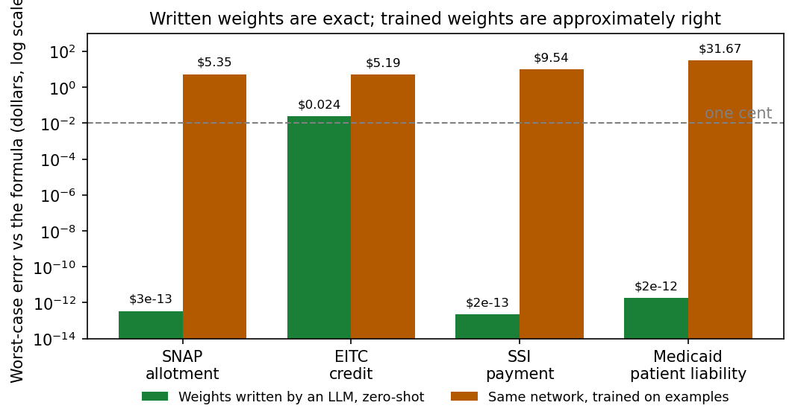
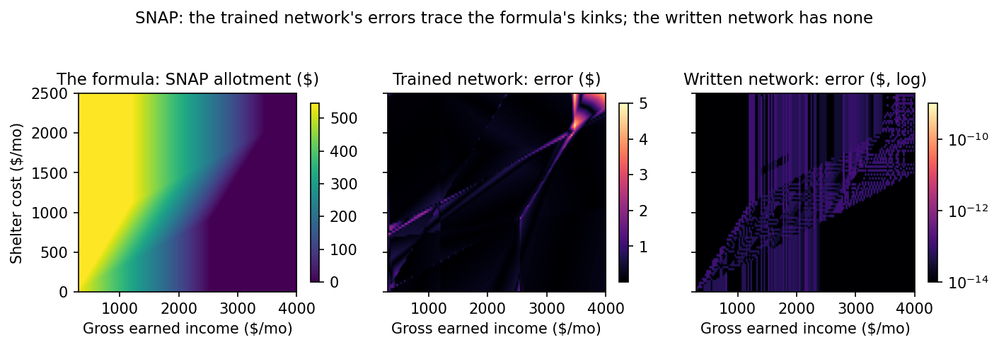
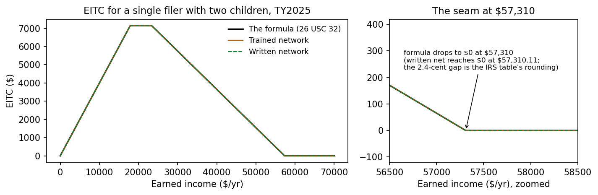
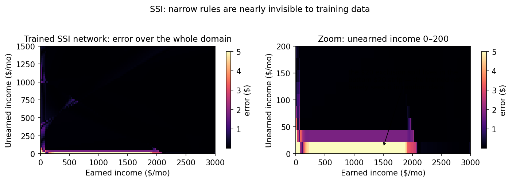

# Weight-Space Programming for the Social Safety Net

**Can a large language model write a neural network that *is* a benefits
formula — exactly, weight by weight, with no training?**

This repo tests the claim of *weight-space programming* in the domain
where being almost right is not right at all: the arithmetic of the
American social safety net.

## In plain language: what this is

A neural network is, mechanically, a big list of numbers (its
"weights") plus a fixed recipe for combining them. Normally those
numbers come from training: show the network millions of examples,
nudge the numbers a little each time, and hope the result computes
what you wanted. Nobody chooses the numbers directly, because nobody
can hold that much arithmetic in their head.

These experiments test whether a language model can choose the
numbers directly. We took four real formulas from U.S. benefit
programs — how much SNAP a household gets, how much EITC a worker
gets, how an SSI payment shrinks as income rises, what a nursing-home
resident on Medicaid owes each month — and asked an AI to write down,
from the formula alone, the exact weights of a small neural network
that computes it. No training data. No trial and error. Then we
checked the network's answer against the formula on tens of thousands
of inputs.

In three of the four cases the written network is not approximately
right. It is the formula, to within a trillionth of a dollar. The
fourth is exact everywhere except one point where the IRS's own
published table contradicts the IRS's own rate by 2.4 cents (details
in the EITC experiment). For comparison, networks *trained* on
examples of the same formulas, the normal way, get close but are
wrong by dollars — and their biggest errors land on the thresholds
and caps where real cases are fought over.

## In plain language: what this is not

- **It is not a benefits calculator you should use.** Each formula
  here is a stripped-down slice of the real rules: one household
  type, a short list of simplifications, no rounding, none of the
  state variations. Every experiment's protocol lists what was left
  out. If you need an actual benefit amount, use your state's
  official calculator or a caseworker.
- **It is not a way to decide who gets benefits.** Real eligibility
  turns on categorical questions — age, disability, household
  composition — that are yes/no gates, not smooth arithmetic. These
  networks only reproduce the money math that runs *after* those
  gates. Nothing here suggests a neural network should decide
  anyone's eligibility, and the author would oppose using it that
  way.
- **It is not a replacement for the normal software that runs these
  programs.** A formula written as ordinary code can be read,
  audited, and litigated line by line. A bag of weights cannot. The
  plausible use for a network like this is narrow: a second,
  independently built copy of a formula, used to *check* the first
  copy. When the two disagree, a human goes and finds out why.
- **It is not proof that AI "understands" anything.** The networks
  here are tiny and the formulas are the kind of arithmetic
  (straight lines joined at breakpoints) that a network can, in
  principle, represent exactly. The finding is that a language model
  can work out how. Whether that extends to bigger networks or
  messier rules is an open question this repo does not answer.
- **The paper this builds on is not settled science either.** It is
  one group's blog post about a model the public cannot use yet.
  This repo is a small, checkable attempt to see if the core trick
  works on a problem where the right answers are known.

## The paper

Rikiya Tomita and collaborators, *Sparks of Weight-Space Programming:
LLMs can natively read & write neural network weights* (Nov 2026):
<https://rikiyat.github.io/blog/weight-space-programming/>

They report that a frontier LLM, given only the rules of a game, writes
small game-playing networks from scratch that outplay networks trained
with PPO for 100 million steps — and that, given a 0.8B language model
with a reasoning-loop defect, it finds the responsible direction in the
weights and removes it, editing 0.016% of the parameters and lifting
MATH-500 from 7.9% to 48.1% with no gradient descent anywhere.

Those are demonstrations on games and model surgery. This repo asks
whether the underlying skill — *reasoning about what a network's
weights must be for the network to compute a stated function* —
transfers to rules that decide what people eat, where they live, and
what care they can afford.

## Why benefits rules

Three reasons this domain is the right stress test, and not just a
novelty:

1. **The functions are exactly checkable.** A SNAP allotment formula is
   continuous piecewise-linear arithmetic with published constants.
   There is no vibes-based grading: a network either reproduces the
   formula to the cent on every input or it doesn't, and where it
   doesn't is itself diagnostic. Few domains offer a ground truth this
   hard.
2. **Approximation fails at exactly the points that matter.** A
   trained network that is right to within a dollar on 96% of inputs
   sounds production-ready — until you look at where the other 4%
   live: at the thresholds, caps, and phase-out boundaries where real
   cases are contested, appealed, and audited. Benefits administration
   already runs on deterministic engines whose whole value is being
   exact at the seams. Any neural artifact in this space has to be
   judged by that standard.
3. **Independent implementations are a live problem here.** Benefit
   rules are re-implemented by every state, vendor, and screening
   tool, and the implementations drift — audits of one widely used
   open-source oracle (see the CivBench label audits) found roughly
   10% of its computed labels wrong, concentrated at boundary cases.
   A weight-compiled network shares *no code path* with a Python or
   Rust oracle. If it agrees with them, that is independent evidence.
   If it disagrees, the disagreement points at a seam worth a human's
   attention. That — a witness, not a replacement — is the realistic
   role for this technique in the safety net.

## Method

Every experiment follows the same pre-registered discipline:

- The rule is **stipulated in full** in the experiment's `PROTOCOL.md`
  — constants verified against primary sources first — so the test
  measures compilation, not recall.
- The LLM **writes the weights by reasoning** (arithmetic on the rule
  constants is allowed; training, fitting, and sampling the oracle are
  not). One shot. The weights are **SHA-256 frozen before the scorer
  is written**, so the order of operations is auditable.
- The same architecture is **trained** with Adam on oracle samples as
  the comparator. (When a first training run visibly underfits, it is
  preserved and a competent run replaces it — strawmen prove nothing.)
- Scoring is a **generic forward pass**: the harness knows no rules.
  Evaluation sets include dense grids, uniform random points, and
  points jittered onto the rule's kink planes, because that is where
  errors hide.

## Experiments and findings

| # | Rule | Zero-shot written weights | Trained baseline (same arch.) | Gate |
|---|---|---|---|---|
| 1 | [SNAP allotment](experiments/snap-allotment/) — FY2026, household of 2 | max error $3×10⁻¹³ over 40,049 pts; 100% within $0.01 | max $5.35; 6.1% within $0.01 | **PASS (exact)** |
| 2 | [EITC credit](experiments/eitc-credit/) — TY2025, 2 children | exact at 99.96% of 2,818 pts; $0.024 at one seam point | max $5.19; 15.7% within $0.01 | Partial — see below |
| 3 | [SSI federal payment](experiments/ssi-payment/) — 2026, individual | max error $2×10⁻¹³ over 32,381 pts; 100% within $0.01 | max $9.54; 26.6% within $0.01 | **PASS (exact)** |
| 4 | [Medicaid patient liability](experiments/medicaid-patient-liability/) — post-eligibility, community spouse | max error $2×10⁻¹² over 86,105 pts; 100% within $0.01 | max $31.67; 3.3% within $0.01 | **PASS (exact)** |
| 5 | [SSI stale-FBR edit](experiments/ssi-stale-fbr-edit/) — experiment 3 recompiled with the stale 2024 FBR ($943), then repaired | stale net exact for 2024 but up to $51.00/mo wrong vs 2026; after a **2-parameter weight edit**: max error $2×10⁻¹³ over 56,381 pts | control, not a baseline: the trained SSI net contains no parameter equal to either year's FBR — a stale constant in trained weights is not even locatable | **PASS (surgical repair, 2 of 1,297 params)** |



The headline comparison. Three of the four written networks sit at
floating-point noise (below $10⁻¹²); the fourth is the EITC seam
explained below. Every trained network, on the same architecture, is
wrong by dollars somewhere.



SNAP, as a surface over income and shelter cost. The trained
network's errors (middle) draw a map of the formula's kinks — the
shelter-deduction boundary, the cap, the exhaustion corner. The
written network's error (right, log scale) is floating-point noise,
largest around $10⁻¹⁰.



EITC, full curve and seam zoom. At the scale of the full curve all
three lines coincide; the differences live in the zoom and in
Figure 1.



SSI. The trained network's errors hug the bottom edge, where the
$20 exclusion spill operates. In the zoomed panel the spill band
lights up across nearly the whole earnings range — the written
network encodes the spill exactly.

Regenerate all four with `python3 docs/make_figures.py` (numpy +
matplotlib only; every number is recomputed from the experiment
artifacts, nothing is drawn from the summary tables).

The EITC "Partial" is the most interesting result in the repo. The
written network is exact everywhere except a single point — $57,310,
the completed phase-out amount — where it is off by $0.024. That is
not a construction error: the IRS table rounds the phase-out's zero
to the nearest $10, so the rule *as published* is discontinuous by
$0.024 at that point, and $0.024 is the smallest error any continuous
network can have there. The experiment caught an inconsistency in its
own protocol's arithmetic (documented in that experiment's
`ERRATUM.md`) — published benefit constants may not multiply out
against their own statutory rates, and any scorer that treats rounded
table amounts as exact will manufacture phantom model errors at the
seams.

The structural pattern across all four: the written constructions are
small (2–4 active units per layer; the rest zeros) and staged —
hinges for breakpoints, min/max assembled layer by layer, floors
applied last. Training, by contrast, spreads the function across every
unit and pays for it at every kink: its worst errors sit exactly on
the kink intersections (e.g., SNAP's shelter-cap + benefit-exhausted
corner, mean error $1.81). Narrow rules fare worst of all under
sampling: SSI's $20 exclusion spill operates in a band 20 dollars
wide, uniform training data almost never lands there, and the trained
net's error in the spill region runs $4.88–$7.22 against $0.15
overall — the written weights encode the spill exactly, for free.

The fifth experiment tests the paper's other direction: *editing*.
The SSI formula was compiled with the stale 2024 benefit rate
($943 instead of $994) — the same defect the CivBench audit found in
published benefits-as-code labels. The stale network is a perfect
implementation of the wrong year: underpaying by up to $51.00 a
month. Scanning its weights for the literal value 0.943 finds the
rate in exactly two places (a hinge bias and the output bias), and
changing just those **2 of 1,297 parameters** to the 2026 rate
restores exactness — the edited file is array-for-array identical
to the network built fresh with the correct rate. The trained SSI
network, by contrast, contains no parameter equal to either year's
rate: in trained weights a constant is smeared everywhere and
addressable nowhere, so it could not be found or fixed without
retraining. Full record in `experiments/ssi-stale-fbr-edit/`.

A second-writer replication (2026-11-02,
`experiments/second-writer-openrouter/`) gave GPT-5.6 Sol and
Gemini 3.1 Pro the same four stipulated rules through OpenRouter,
one stateless prompt each. Both compiled SNAP, SSI, and Medicaid
exactly. On EITC they split: Gemini reproduced the original
writer's first attempt metric for metric (Partial, $0.024 seam),
while GPT-5.6 Sol returned no weights at all — it derived the
$0.024 discontinuity from the constants and declined to submit an
inexact network. Total measured cost of the replication: $0.65.

The reading direction is also done (2026-11-02,
`experiments/weight-reading/`): eleven anonymized networks were
handed to fresh readers — GPT-5.6 Sol, Gemini 3.1 Pro, and the
original author cross-reading the others' work — with only the
weights, the architecture, and the meaning of the inputs. Every
compiled network was read exactly: claimed formulas behaviorally
identical to the artifacts, every constant recovered. Given the
stale-FBR network plus a current-law sheet, both blind readers
flagged the stale $943 rate, one quantifying the harm at exactly
$51 a month. The trained SSI network broke the pattern in the
instructive way: both readers named the program but invented
different benefit rates ($1,000; $914) for a constant that training
never wrote down anywhere, and 25 input/output samples did not
rescue them (one reader's error quadrupled to $414). A compiled
network can be audited by a stranger; a trained one can only be
recognized.

## Guardrails

The plain-language section at the top is the short version. The
technical version: these experiments cover the *arithmetic cores* of
programs only. Categorical gates are step functions a continuous
network cannot represent exactly, and determinations belong in
deterministic code regardless. The defensible uses for a
weight-compiled network are independent witness implementations for
verification, and seam-hunting. Each protocol lists its
simplifications explicitly; the stipulated formulas are research
artifacts, not legal advice.

## Layout

```
experiments/
  snap-allotment/               FY2026 SNAP allotment, hh of 2
  eitc-credit/                  TY2025 EITC, 2 children (incl. ERRATUM.md)
  ssi-payment/                  2026 SSI federal payment, individual
  medicaid-patient-liability/   Medicaid post-eligibility liability
  ssi-stale-fbr-edit/           Repairing a stale constant by weight edit
  second-writer-openrouter/     GPT-5.6 Sol + Gemini 3.1 Pro replication
  weight-reading/               Fresh readers identify rules from weights alone
```

Figures live in `docs/figures/` (generator: `docs/make_figures.py`).

Each experiment is self-contained: `PROTOCOL.md` (pre-registration),
`oracle.py` (the stipulated rule), `mlp.py` (generic forward pass),
`zero_shot/` (the weight constructions, with derivations, plus
`FREEZE.json` hash records where applicable), `train_baseline.py`,
`score.py`, `results/` (raw scores), `RESULTS.md` (verdict).

The first run (SNAP + EITC) was originally executed as one combined
experiment; its unmodified record — combined protocol, freeze hashes,
scorer, and results — is preserved in `archive/first-run-combined/`.
The per-experiment folders are the canonical layout going forward,
and their scorers reproduce the archived numbers exactly.

## Reproduce

```bash
cd experiments/snap-allotment
python3 score.py zero_shot     # needs numpy only
python3 score.py trained
# retrain a baseline (needs torch):
python3 train_baseline.py
```

## What's next

- Extend the witness pattern to the remaining arithmetic cores the
  CivBench label program cares about (Medicaid medically-needy share
  of cost with SSI-style income counting; SSI couple rate).

## License

Creative Commons Attribution 4.0 International (CC BY 4.0).
Copyright (c) 2026 Cory Trimm.

Use it, share it, adapt it, cross-reference it, cite it — for any
purpose — provided you give credit to **Cory Trimm**. Suggested
citation: Trimm, Cory, *Weight-Space Programming for the Social
Safety Net* (2026), <https://github.com/ctrimm/weight-space-programming>.
Full terms in [LICENSE](LICENSE).
