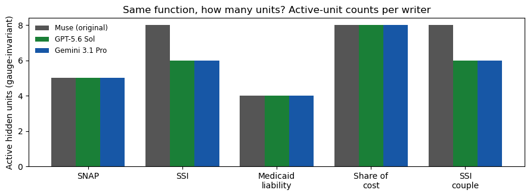

# Results — canonical circuits under gauge transformations

**Verdict: most of the visible difference between independent
writers' weights is relabeling. Under permutation + positive
scaling, the writers collapse to a single canonical circuit in two
rules outright, and to the *same* circuit shared by the two API
writers in two more. The exceptions are real circuit differences,
and they are identifiable.**

Both controls behaved: the array-identical share-of-cost pair came
out gauge-equivalent (as it must), and the EITC negative control —
original attempt 2 vs Gemini, which compute *different* functions
at the $57,310 seam — came out non-equivalent (as it must).

## Equivalence, pair by pair

| Rule | Original vs GPT | Original vs Gemini | GPT vs Gemini |
|---|---|---|---|
| Medicaid liability | equivalent | equivalent | equivalent |
| Share of cost | equivalent | equivalent | equivalent |
| SNAP | equivalent | **different circuit** | **different circuit** |
| SSI | **different circuit** | **different circuit** | equivalent |
| SSI couple | **different circuit** | **different circuit** | equivalent |
| EITC (attempt 1 vs Gemini) | — | **different circuit** (same function) | — |
| EITC (attempt 2 vs Gemini) | — | different circuit (different function — control) | — |

## Reading the differences

- **Medicaid liability and share of cost have one canonical
  circuit.** Three writers, working independently (two of them
  from a bare prompt), produced the same program up to relabeling.
  Parameter values that looked wildly different — GPT's share-of-
  cost net differed from the original in 66 entries — were a unit
  swap and nothing else.
- **In SSI and the couple rule, GPT and Gemini agree with each
  other and the original is the outlier** — not in function (all
  exact) but in verbosity: the in-session construction carries 3
  active units in the final hidden layer where both API writers
  use 1. The extra units are pass-through staging from the
  subroutine-style construction. Same computation, longer path.
- **In SNAP, Gemini is the outlier**: identical active-unit counts
  (3 + 2), identical function, different wiring — its
  dollar-denominated layer-1 units feed a differently-arranged
  second layer. A genuinely different decomposition of the same
  formula, not a relabeling.
- **EITC attempt 1 vs Gemini** is the method's resolution limit,
  disclosed in the protocol: functionally identical (Gemini
  reproduced attempt 1 metric-for-metric), but the hinge
  arrangement differs beyond permutation and scaling, so canonical
  forms differ. Gauge equivalence is a *sufficient* certificate of
  sameness, not a necessary one; the functional scores remain the
  arbiter.

## What this establishes

For witness-based verification, the interesting question is never
"are the parameters equal" — they almost never are. It is "are the
differences explainable as gauge." Here, most are: cross-writer
agreement in this repo is agreement on one canonical circuit per
rule in four of six cases, which is substantially stronger evidence
than three black boxes returning the same numbers. Where the
circuits genuinely differ (Gemini's SNAP, the EITC pair), the
method says so, and in the one case where the functions also
differ (EITC attempt 2), it correctly refuses to collapse them.

A methodological note, recorded because it cost a debugging pass:
the canonical edge weight between two hidden units must be
normalized by *both* endpoints' scales (W x s_source / s_target).
Normalizing by one endpoint only — the first version of this
analysis — falsely split the SNAP original/GPT pair, whose
difference is a pure rescaling of one unit. The control pairs
caught it: a method that cannot recognize a known rescaling is
measuring its own bug.

## Cost

**$0.** Local analysis of frozen weights.
