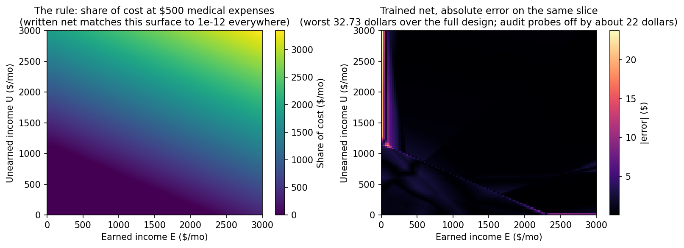

# Results — Medicaid medically-needy share of cost (California)

**Verdict (pre-registered gate): the zero-shot construction PASSES —
exact.** Worst-case error 1.36e-12 dollars over 43,607 evaluation
points; 100% of points within one cent in every subset. Weights were
SHA-256 frozen before scoring (`FREEZE.json`).

| Arm | Max abs err | Mean abs err | Within $0.01 | Within $1 |
|---|---|---|---|---|
| **Written zero-shot** | **$0.0000000000014** | ~0 | **100%** | 100% |
| Trained on examples | $32.73 | $0.81 | 3.30% | 81.0% |

## The audit probes

This experiment exists because of two real fixtures. The CivBench
audit found the benefits-as-code Medicaid oracle treating any share
of cost as ineligibility; under 42 CFR 435.831 the correct outcomes
are enrollment *with* a share of cost — $1,380 for the bac-medicaid-038
household (countable income such that C − 600 − 500 = 1,380) and $880
for bac-medicaid-039 (medical expenses $1,000 instead of $500). Both
households are named probes in this design:

| Probe | Correct SOC | Written net | Trained net |
|---|---|---|---|
| bac-medicaid-038 pattern | $1,380 | **$1,380.00** | $1,358.10 (−$21.90) |
| bac-medicaid-039 pattern | $880 | **$880.00** | $858.19 (−$21.81) |

The written net reproduces the audit's corrected values exactly. The
trained net underbills both households by about $22 — the direction
of error that quietly shifts medical costs onto the enrollee's
provider or leaves bills unmet in the real program.

## Trained baseline, by evaluation set

| Set | Max | Mean | Within $0.01 |
|---|---|---|---|
| Grid (18,605) | $32.73 | $0.77 | 3.11% |
| Random (20,000) | $23.21 | $0.56 | 3.89% |
| Kink-concentrated (5,000) | $32.35 | $1.98 | 1.68% |

## What this tests that the earlier experiments did not

Composition. Every prior rule in this repo is a single program. This
one reuses the entire SSI income-counting machine — the $20 general
exclusion, the spill of its unused part into the earned exclusion,
the $65, the halving — as a *subroutine* inside a different program,
with a different threshold (the $600 California medically-needy
income level instead of a benefit rate) and an extra input (incurred
medical expenses) subtracted after the count. The written construction
carries the subroutine over unchanged; only the final stage is new.

## Limits

Stipulated simplifications (in PROTOCOL.md): individual only; no
health-insurance premium deduction (real CA share-of-cost cases often
have one); no rounding; categorical eligibility out of scope — the
net computes the share of cost, never whether someone qualifies. The
$600 MNIL is California's long-frozen individual level; other states
and household sizes differ. As everywhere in this repo: a cross-check
artifact, not a determination.

## Cost

**$0 in API spend.** The construction was written in-session by
Muse Spark; the baseline trained on local CPU; scoring is local
numpy. No external model calls. (The repo's cumulative API total is
in the top-level README's cost section.)
