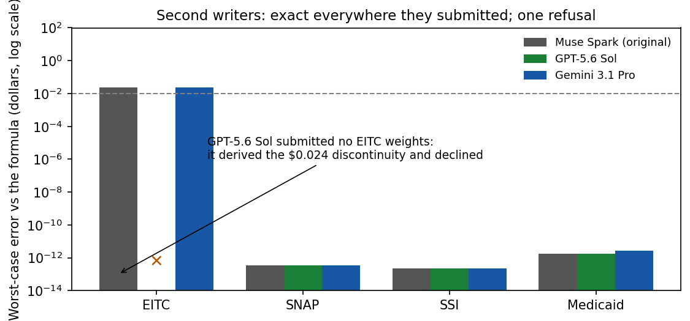

# Results — second weight writer (OpenRouter)

**Verdict: the capability replicates across vendors.** Two
non-Anthropic frontier models, given the same stipulated rules and
architectures as the original run (one stateless prompt each, no
evaluation points, no oracle code), produced exactly-compiled
networks in 6 of 8 cells, a functionally identical reproduction of
the original writer's first attempt in a seventh, and — in the
eighth — a correct refusal that is itself a finding.

## Scores (original evaluation designs, unchanged gates)

| Writer | EITC | SNAP | SSI | Medicaid |
|---|---|---|---|---|
| Muse Spark (original, in-session) | Partial ($0.024 seam; attempt 2) | PASS (3.4e-13) | PASS (2.3e-13) | PASS (1.8e-12) |
| GPT-5.6 Sol (OpenRouter) | **no submission** | PASS (3.4e-13) | PASS (2.3e-13) | PASS (1.8e-12) |
| Gemini 3.1 Pro (OpenRouter) | Partial ($0.024, see below) | PASS (3.4e-13) | PASS (2.3e-13) | PASS (2.7e-12) |

Max abs errors in dollars. Full metrics in
`results/second_writer_scores.json`; per-call costs in
`results/cost_log.json`; raw replies in `raw/`.

## The EITC cell split three ways

The stipulated EITC rule is, as this repo's ERRATUM documents,
internally inconsistent by $0.024 at $57,310 (the published
phase-out endpoint is the statutory zero rounded to the nearest
$10). Three writers, three behaviors:

- **Original writer, attempt 1:** built to the published table;
  the tail sits $0.024 high past the endpoint. (Attempt 2, after
  human review, moved the hinge to the true zero.)
- **Gemini 3.1 Pro:** independently reproduced attempt 1 —
  functionally identical, metric for metric (max $0.024, mean
  $0.00436, 81.83% within a cent). It built what the table says.
- **GPT-5.6 Sol:** returned no weights, twice. Its reply, verbatim:
  *"No valid weights exist. Any finite affine/ReLU network is
  continuous, but the specified credit is discontinuous at
  x=57310..."* — with the left-hand limit computed correctly at
  $0.024. It found the inconsistency from the constants alone,
  before constructing anything, and declined rather than submit an
  inexact network.

Under the pre-registered gate, GPT's cell is a FAIL (no
submission), and it stays recorded that way — the protocol allowed
two attempts, both were used, and no third "just do your best"
call was made. But the ranking depends on what you want a witness
implementation for: Gemini (and the original attempt 1) silently
embed the table's rounding as if it were law; GPT refused to
certify an impossibility and said exactly why. For the CivBench
label program — where published constants repeatedly failed to
multiply out — the refusal behavior is arguably the most valuable
of the three, and the "do it anyway" behavior is how bad labels
get made. Both readings are in the data; the gate verdict is not
one of them.

## Cost accounting (measured, not estimated)

- Runner-logged calls: 10 (8 first attempts + GPT's 2 EITC
  attempts), **$0.6336 total** per the API's own usage accounting.
- Account-level verification: OpenRouter usage rose from
  $75.9640 (checked immediately before the run) to $76.6170 —
  a delta of **$0.653**. The ~$0.019 difference is the first
  launch attempt, killed ~1 minute in when its process management
  proved unreliable; its in-flight EITC call completed
  server-side and billed, with no response saved. Total actual
  spend attributable to this experiment: **$0.65 against the
  $10 hard cap** Cory set. Balance after: $23.38.
- Per-model: GPT-5.6 Sol $0.129 across 5 calls; Gemini 3.1 Pro
  $0.505 across 4 calls. Gemini's calls cost ~4x GPT's here
  (longer completions), at one-quarter of the originally feared
  per-call rates.

## What this establishes, and what it doesn't

- Exact weight compilation of stipulated piecewise-linear benefit
  formulas is **not a single-model trick**: three models from
  three vendors converge on it, with error fingerprints at the
  same floating-point magnitudes (the constructions are canonical
  enough that independent writers land on functionally identical
  networks).
- Conditions were harsher here than in the original run (one
  stateless call vs an interactive session; declared in
  PROTOCOL.md), which makes the replication stronger, not weaker.
- It does not establish anything about messier rules, larger
  networks, or models below the frontier tier. The reading
  direction (identify an unknown network's rule) remains unrun.
