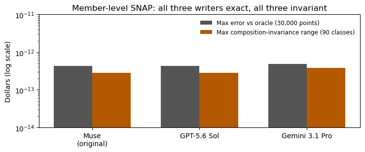

# Results — second-writer replication, member-level SNAP

**Verdict: PASS in both cells, first attempts, no retries.** Both
outside writers, given the member-level SNAP rule as bare text and
no hint that the allotment is composition-invariant, wrote
networks that are exact — and invariant — on the original
experiment's full design.

| Writer | Max abs error (30k pts) | Composition range (90 classes) | Should-change delta error | Gate |
|---|---|---|---|---|
| Muse Spark (original) | 4.3e-13 | 2.8e-13 | 4.4e-13 | PASS |
| GPT-5.6 Sol | 4.3e-13 | 2.8e-13 | 4.4e-13 | PASS |
| Gemini 3.1 Pro | 4.8e-13 | 3.8e-13 | 3.6e-13 | PASS |

Both submissions are near-minimal (GPT 34 nonzero parameters,
Gemini 33, original 34), and neither is array-identical to the
original (max parameter difference 2.0) — this time the convergence
is at the level of function and circuit shape rather than literal
arrays. Both writers combined the members' incomes in their first
layer, unprompted: the invariance is a consequence of their staging
choices, exactly as it was for the couple rule.

The should-change control matters here. A writer could in
principle have "solved" composition invariance by treating all
income alike — which would be wrong, because earned and unearned
income are treated differently by the rule. Both writers' networks
reproduce the oracle's earned-to-unearned shift deltas to within
5e-13: invariant where the law is invariant, sensitive where the
law is sensitive.

## Cost — measured

**$0.1949** across 2 calls (GPT-5.6 Sol $0.0278; Gemini 3.1 Pro
$0.1671) — inside the ~$0.25 estimate and far inside the $5 cap
Cory set for the queue. Reconciled exactly against the account
aggregate: total usage moved $78.1734 -> $78.3683, a delta of
$0.194892 matching the response-level sum to the tenth of a
millidollar. (An interim completion notice during the run carried
garbled per-call figures totalling $0.2132; the runner's cost log
and the account aggregate agree with each other, and they are the
figures of record.) This was the only spend in the entire queue;
the project's cumulative API total is now **$2.40**, and the
account balance is $21.63.
