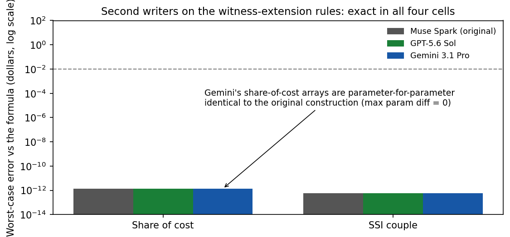

# Results — second-writer replication of the witness extension

**Verdict: the replication holds on the harder rules, in all four
cells.** GPT-5.6 Sol and Gemini 3.1 Pro, given only the stipulated
formulas and fixed architectures for the two witness-extension rules
(one stateless prompt each, no evaluation points, no oracle code, no
hint of the original constructions), each produced an exactly
compiled network on the first attempt. No retries were needed; no
cell was refused.

## Scores (original evaluation designs, unchanged gates)

| Writer | Share of cost (43,607 pts) | SSI couple (44,762 pts) |
|---|---|---|
| Muse Spark (original, in-session) | PASS — max err 1.36e-12 | PASS — max err 5.83e-13 |
| GPT-5.6 Sol (OpenRouter) | **PASS — max err 1.36e-12** | **PASS — max err 5.83e-13** |
| Gemini 3.1 Pro (OpenRouter) | **PASS — max err 1.36e-12** | **PASS — max err 5.83e-13** |

Max abs errors in dollars; 100% of points within one cent in every
cell and every subset. Full metrics in
`results/replication_scores.json`; per-call costs in
`results/cost_log.json`; raw replies in `raw/`; prompt hashes in
`results/prompt_freeze.json`; weight hashes in `weights/FREEZE.json`.

Details that matter:

- **Share of cost:** both API writers reproduce the CivBench audit
  probes exactly — $1,380 and $880 — the two values the original
  benefits-as-code oracle got wrong. The composition (SSI counting
  as a subroutine inside a second program) compiled cross-vendor
  with no degradation.
- **Couple payment:** both writers are exact on the zero-member
  boundary slices (max 3.41e-13), the slices where the trained
  baseline made its worst errors. The once-per-couple exclusion
  semantics survived restatement in a bare prompt.
- All four submissions use exactly **16 nonzero parameters** — the
  same sparsity as the original constructions.

## The convergence is stronger than functional

Scoring establishes that all three writers compute the same
function. Comparing the weight arrays themselves:

- **Gemini's share-of-cost network is parameter-for-parameter
  identical to the original in-session construction** — every array
  equal, maximum parameter difference 0, and the submitted file's
  SHA-256 matches the original experiment's pre-registered freeze
  hash. Two models, given the same stipulated rule, wrote down the
  same numbers.
- The other three submissions (GPT on share of cost; both writers
  on the couple rule) reach the identical function through
  *different* parameter values (max parameter difference 1.0 and
  2.98 respectively) — same program, different but equivalent
  encodings.

So the construction is canonical where the staging is forced, and
degenerate only where the rule itself leaves freedom. For the
witness use case this is the best available outcome: independent
writers not only agree on the answers, they mostly agree on the
artifact.

## Cost accounting (measured, not estimated)

- Four calls, all first attempts, **$0.2095 total** per the API's
  own usage accounting — under the ~$0.35 estimate given before the
  run and well under the protocol's $0.75 hard cap.
- Per model: GPT-5.6 Sol $0.0365 across 2 calls; Gemini 3.1 Pro
  $0.1730 across 2 calls.
- Account-level verification: OpenRouter total usage rose from
  $77.9638 (checked immediately before) to $78.1734 after the final
  call posted — a delta of **$0.2095**, matching the response-level
  log. (The runner's immediate after-check caught the aggregate at
  $0.1295, before the last Gemini call posted; the reconciliation
  above uses a later read.) Balance after: $21.83.

## What this establishes, and what it doesn't

- Exact compilation replicates cross-vendor on composition and
  input-combination rules, not just on the single-program formulas
  of the first pilot. Across both second-writer experiments, the
  only non-exact cells remain the two EITC behaviors (reproduction
  of the table's rounding; a principled refusal) — both caused by
  the stipulated rule's own inconsistency, not by writer failure.
- The declared asymmetries of the first pilot apply unchanged:
  stateless single prompts vs an interactive session, and a sparse
  output format that favors sparse constructions.
- Nothing here speaks to rules with categorical gates, rounding
  conventions, or state supplements; those remain outside what a
  continuous network can witness exactly, as the repo's guardrails
  state.
