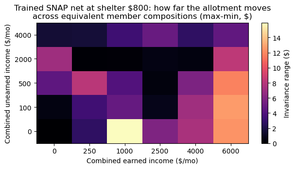

# Results — SNAP allotment, member-level household composition

**Verdict: the compiled construction is exact and invariant
(PASS). The trained baseline reproduces the couple rule's failure
in a second program family — composition-dependent answers in
96.7% of totals classes — and the second-writer replication
(`../second-writer-snap-composition/`) shows both outside writers
independently avoiding the failure.**

| Arm | Max abs err (30k pts) | Mean | Within $0.01 | Composition range (max / mean) | Should-change delta err (max) |
|---|---|---|---|---|---|
| Zero-shot (Muse) | 4.3e-13 | 1.6e-14 | 100% | 2.8e-13 / 2.0e-14 | 4.4e-13 |
| GPT-5.6 Sol | 4.3e-13 | ~5e-14 | 100% | 2.8e-13 / 5.3e-14 | 4.4e-13 |
| Gemini 3.1 Pro | 4.8e-13 | ~5e-14 | 100% | 3.8e-13 / — | 3.6e-13 |
| **Trained baseline** | **$64.60** | $0.29 | 10.8% | **$18.32 / $5.46** | **$6.00** |

(GPT/Gemini rows are scored in the replication folder on this
experiment's design, unchanged.)

## What the three tests show together

- **Invariance (should-not-change):** the trained net's allotment
  depends on which member carries the income in 96.7% of
  composition classes — mean movement $5.46, worst $18.32. Same
  totals, same shelter cost, same household under the rule;
  different answer. The couple experiment's headline failure is not
  an SSI quirk.
- **Sensitivity (should-change):** moving $100 from earned to
  unearned within the same member must change the allotment (the
  oracle's delta runs to −$9.00 where the shelter interaction
  compounds). The compiled nets track the oracle's delta to
  4e-13. The trained net's delta is wrong by up to $6.00 — it is
  not merely invariant where it shouldn't be; it is *insensitive in
  the wrong places and sensitive in the wrong places*, because what
  it learned is a smooth blur of the rule rather than the rule.
- **Accuracy:** the trained net's worst error ($64.60) sits on the
  kink set, as with every other trained baseline in this repo; its
  mean error ($0.29) again looks presentable next to a 10.8%
  within-a-cent rate.

## Construction note

The member-level domain lets adjusted income go negative (zero
income puts A at −$209), which the totals-level SNAP construction
never faced. The construction therefore carries A as a hinge pair
(relu(A), relu(−A)) into the second layer, where the shelter and
floor algebra proceeds exactly as in the totals-level version,
including the positive-threshold identity that lets the final
allotment floor be computed from the unfloored net income. Five
active units in layer 1, two in layer 2, 34 nonzero parameters —
and both API writers independently landed on the same size (34 and
33 nonzero), combining the members' incomes in the first layer
without being told the rule was composition-invariant.

## Cost

**$0** for this folder (in-session construction, local training).
The replication's measured API cost ($0.1949) is reported in its
own folder; it is the queue's only spend.
