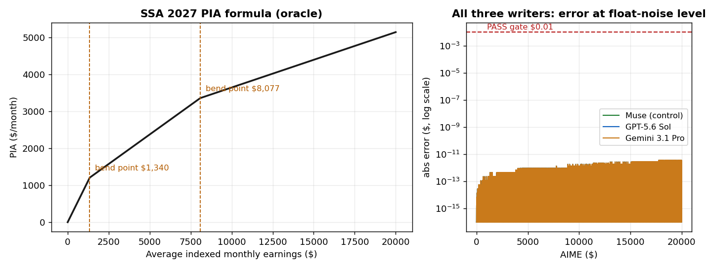

# Results — held-out test: SSA PIA from regulatory text only

Pre-registered in PROTOCOL.md (committed before any construction
or API call). Run 2026-11-03.

## Question

Every rule compiled in this repo before today was restated as a
cleaned formula before any writer saw it. Does exact weight-writing
survive when the writer gets only the regulator's published text?

## Setup

- Rule: Social Security primary insurance amount (PIA), worker
  first eligible in 2027, as published by SSA
  (SOURCE_TEXT.md, retrieved 2026-11-03). No prior experiment in
  this repo touches Social Security; the 2027 formula is the
  version SSA currently publishes.
- Writers received the verbatim SSA text and the fixed network
  spec, and were told to implement the (a)+(b)+(c) sum only, not
  the rounding sentence. No cleaned formula, no hinge form, no
  evaluation points, no oracle code.
- Writers: GPT-5.6 Sol and Gemini 3.1 Pro via OpenRouter (one call
  each, first-attempt parses, no retries), plus an in-session
  control construction hash-frozen before scoring
  (results/FREEZE.json).
- Scoring: 120,003 points (grid, both bend-point neighborhoods at
  $0.001 resolution, seeded randoms) against an independent
  piecewise oracle. Gate: PASS = max abs error <= $0.01.

## Results

| Writer | Max abs err | Mean abs err | Within $0.01 | Verdict |
|---|---|---|---|---|
| Muse Spark (control) | 3.64e-12 | 4.69e-13 | 100% | PASS |
| GPT-5.6 Sol | 3.64e-12 | 4.69e-13 | 100% | PASS |
| Gemini 3.1 Pro | 3.64e-12 | 4.69e-13 | 100% | PASS |

The identical error profiles are not a coincidence: **all three
writers returned the same eight nonzero parameters, in the same
positions, with the same values** (three hinge units: slopes 9,
-5.8, -1.7 in scaled units; thresholds at the two bend points).
Given prose percentages and bend points, three models from three
vendors converged on the identical circuit — the same convergence
the canonical-circuits experiment found for Medicaid, here
arrived at independently from regulatory text.

## What this does and does not show

- It removes the "handed the cleaned formula" objection for this
  class of rule: prose in, exact weights out, three for three.
- The rule is single-input with three segments — the simple end
  of the spectrum, as declared in the protocol. The writers may
  also have seen this formula in training data; the experiment
  tests weight-writing from text, not rule discovery.
- The SSA text's final sentence (round down to the next lower
  $0.10) was deliberately excluded here. It is not a detail:
  see ../ssa-rounding-boundary/ for why no network can implement
  it exactly.

## Cost

Measured from API usage accounting: GPT-5.6 Sol $0.0111,
Gemini 3.1 Pro $0.0720. **Total $0.0831** of the $0.50 cap.
Project API total after this run: $2.48.
