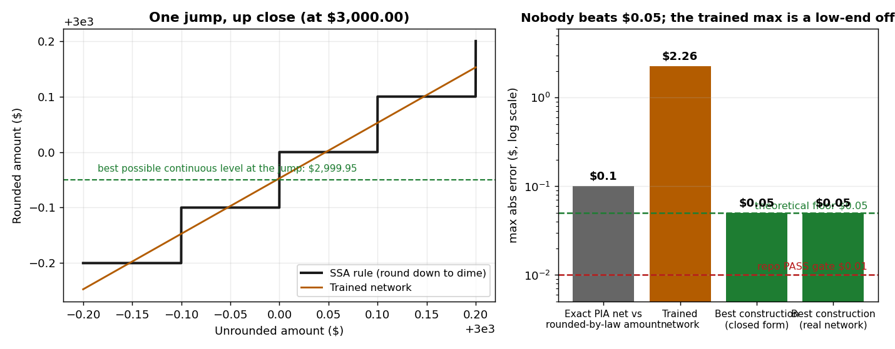

# Results — boundary case: SSA rounding

Pre-registered in PROTOCOL.md (committed before any construction,
training, or scoring). Run 2026-11-03. No API calls; $0 spend.

## The rule and the prediction

SSA's PIA text (../ssa-pia-heldout/SOURCE_TEXT.md) ends: "We
round this amount to the next lower multiple of $.10." That
rounding is a step function. A ReLU network computes a continuous
function, and the protocol registered the consequence in advance:
at a jump of $0.10, any continuous candidate sits at one value
while the truth is $0.10 apart on the two sides, so **no network
can score better than $0.05 max error** on any interval containing
a jump — and this repo's $0.01 PASS gate is provably unattainable
for this rule. The whole-dollar rounding of the monthly benefit
in the same SSA text has a floor of $0.50 by the same argument.

## Results

| Arm | Max abs err | Mean abs err | Within $0.01 |
|---|---|---|---|
| 1. Best construction, real network, $0–$20 (200 jumps) | **$0.0500** | $0.0025 | 92.0% |
| 2. Best construction, closed form, $0–$5,000 | **$0.0500** | $0.00025 | 99.2% |
| 3. Trained network (15,000 steps), $0–$5,000 randoms | $2.26 | $0.048 | 18.7% |
| 4. Exact PIA net vs the rounded-by-law amount | $0.0999 | $0.051 | 11.0% |

**The floor held.** The centered-ramp construction (exact
everywhere except in a hairline ramp through each jump's
midpoint) attains $0.0500 — the theoretical optimum, to four
decimal places — in both a real 400-unit network file and closed
form. Nothing measured below it on the jump-resolved grids. (On
coarse grids a steep approximator can *sample* under $0.05,
because the grid steps over the worst points; the floor is a
statement about the continuum, and the jump-resolved window is
where it binds.)

**The trained arm found the same strategy, plus a boundary
artifact.** Across the $1,000–$3,000 bands its mean error is
$0.0250 — the midpoint signature, exactly the pattern predicted —
with grid maxima of $0.042–0.058. But it also carries a positive
offset at the very bottom of the range ($2.17 at $0, decaying
through the first $500), which sets its headline max at $2.26.
The protocol's guess of a trained max "near $0.10" **missed**;
the mechanism is visible in the band table in
results/boundary_scores.json: training fits the dense middle of
the range and leaves the first sliver of input space
undercorrected. A first 6,000-step run was worse (max $7.40,
mean $0.177; preserved in results/arm3_run1_6000steps.json) and
was replaced by the repo-standard 15,000 steps; the offset
shrank but did not vanish.

**Composition is the practical lesson.** Arm 4 changes nothing
about the network — it is the exact PIA construction from the
held-out experiment, scored against what the law actually pays
(the rounded amount). It is off by up to $0.0999, mean $0.051,
and within a cent only 11% of the time. A pipeline that is exact
at every representable step still misses the statutory answer by
up to a dime, because the last step of the statute is a rounding
no continuous system can perform. Any real deployment has to do
the rounding in ordinary code, after the network — which is the
guardrail this repo has stated from the start, now measured
instead of asserted.

## What this bounds

- **Inside the boundary:** continuous piecewise-linear rules —
  every formula compiled in this repo — are exactly
  representable, and three independent writers produce them.
- **At the boundary:** discontinuous rules (rounding, lookup
  tables, categorical gates) are representable only to half
  their jump size. For a dime that is $0.05; for a whole-dollar
  round, $0.50; for an eligibility gate, the "jump" is the whole
  decision.
- Average-case scores hide all of this exactly the way they hid
  the SSI couple defect: the best construction is within a cent
  99.2% of the time and still cannot pass a max-error gate,
  ever. Max-error and property tests are not pedantry; for
  discontinuous law they are the whole question.

## Process note

Two uncheckpointed training runs were lost mid-flight to this
sandbox's process/storage volatility (one reported success with
its output files missing — the failure mode behind DECISION_LOG
D14). The shipped run was retrained in checkpointed chunks with
the checkpoint synced after each chunk; the discarded
6,000-step run's scores are preserved alongside.
