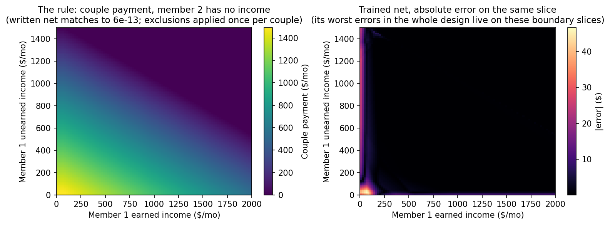

# Results — SSI couple payment (2026)

**Verdict (pre-registered gate): the zero-shot construction PASSES —
exact.** Worst-case error 5.83e-13 dollars over 44,762 evaluation
points; 100% of points within one cent in every subset, including
both zero-member boundary slices. Weights were SHA-256 frozen before
scoring (`FREEZE.json`).

| Arm | Max abs err | Mean abs err | Within $0.01 | Within $1 |
|---|---|---|---|---|
| **Written zero-shot** | **$0.00000000000058** | ~0 | **100%** | 100% |
| Trained on examples | $48.11 | $0.32 | 21.2% | 94.8% |

## Trained baseline, by evaluation set

| Set | Max | Mean | Within $0.01 |
|---|---|---|---|
| Random interior (25,000) | $10.17 | $0.029 | 27.6% |
| Kink-concentrated (5,000) | $10.37 | $0.099 | 25.0% |
| Slice: member 2 zero (7,381) | $46.06 | $0.70 | 13.9% |
| Slice: member 1 zero (7,381) | $48.11 | $1.07 | 4.08% |

The trained net is at its best in the interior and at its worst
exactly where one member of the couple has no income at all — a whole
input channel sitting at its boundary value. The stipulated rule is
perfectly symmetric in the two members; the trained approximation is
not (compare the two slice rows), while the written net's slice
statistics are identical to the last digit, as the rule requires.

## What this tests

Two things the individual-SSI experiment could not reach:

1. **Input combination before counting.** SSI counts a couple's
   income combined, and the $20 and $65 exclusions apply *once per
   couple*, not once per person. A construction (or a benefits
   oracle) that applies the exclusions per spouse understates
   countable income — by up to $20 on the unearned side and up to
   $42.50 on the earned side after the halving — and overstates the
   payment by up to roughly $62.50 a month. The written net combines
   first, then counts, and is exact on the slices where one member
   contributes nothing.
2. **Coverage of the audited slice.** The CivBench SSI audit found
   the benefits-as-code labels had shipped stale 2024 rates as 2026.
   The couple rate is where that error is largest in dollars: 2026's
   $1,491 against 2024's $1,415 is a $76 difference, against $51 for
   an individual. The written construction carries the 2026 rate as
   an explicit, locatable constant, the same way the individual net
   does — the property the editing experiment showed makes a stale
   rate repairable in two parameter edits.

## Limits

Stipulated simplifications (in PROTOCOL.md): both members' income
counted in the same month with no deeming from third parties, no
in-kind support and maintenance, no state supplement, no rounding.
The net computes a payment amount; eligibility (resources, living
arrangement, categorical) is out of scope, as everywhere in this
repo.

## Cost

**$0 in API spend.** The construction was written in-session by
Muse Spark; the baseline trained on local CPU; scoring is local
numpy. No external model calls. (The repo's cumulative API total is
in the top-level README's cost section.)
