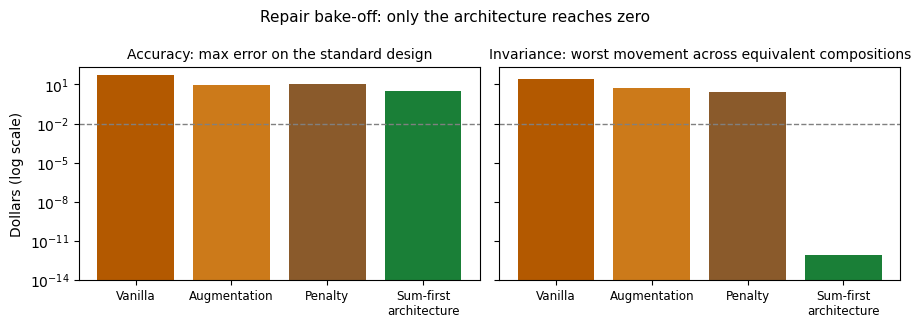

# Results — SSI couple repair bake-off

**Verdict: training-side repairs shrink the invariance defect by
an order of magnitude but leave it nearly universal; the
architectural repair eliminates it exactly, and is also the most
accurate learned net of the four.** The invariance is not a
training problem. It is a hypothesis-space problem.

| Arm | Accuracy max | Accuracy mean | Within $0.01 | Invariance max range | Invariance mean range | Classes moving > $0.01 |
|---|---|---|---|---|---|---|
| Vanilla (existing baseline) | $48.11 | $0.319 | 21.2% | $25.15 | $3.64 | 98.9% |
| Augmentation | $8.98 | $0.063 | 43.4% | $5.30 | $0.88 | 95.6% |
| Penalty (symmetry loss) | $11.28 | $0.038 | 58.3% | $2.60 | $0.41 | 94.4% |
| **Sum-first architecture** | **$3.33** | **$0.020** | 55.6% | **8.9e-13** | **1.6e-13** | **0.0%** |
| Compiled constructions (reference) | ~5e-13 | ~1e-14 | 100% | ~5e-13 | ~1e-13 | 0.0% |

## Arm by arm, against the pre-registered expectations

- **Augmentation** (train on random splits of random totals):
  defect shrinks ~5x at the max, ~4x at the mean — but the share of
  classes that move at all barely changes (98.9% → 95.6%). Showing
  the net millions of equivalent compositions teaches it to keep
  them *closer together*, not *equal*. Expectation confirmed.
- **Penalty** (vanilla sampling + a symmetry loss against a random
  re-split): the strongest training-side repair, as expected —
  max range $2.60, mean $0.41, and the best within-a-cent accuracy
  of the three 4-input arms (58.3%). Still: 94.4% of classes move.
  A penalty can price a violation; it cannot make the violation
  unrepresentable. The accuracy picture is mixed rather than a
  clean cost (worse max than augmentation, better mean).
- **Sum-first** (the net receives only the combined totals):
  invariance is exact by construction (max range 8.9e-13 — float
  noise, same floor as the compiled nets) — and, less obviously,
  it is the most accurate learned arm on both max ($3.33) and mean
  ($0.020) error. Removing the per-member inputs removes the
  per-member-exclusion failure mode *and* two dimensions of
  fitting noise. The expectation held on both clauses.

## The honest limit of the architectural repair

Sum-first is still a learned approximation: its worst point error
is $3.33, at the rule's kinks, where every trained net in this repo
is worst. Architecture buys the *structural property* exactly and
for free; it does not buy exactness. The compiled constructions
remain three orders of magnitude more accurate than the best
trainable arm on max error, and they are the only entries in the
table that are both exact and invariant.

## What this establishes

For any learned component inside a benefits pipeline, the
remediation ladder is now measured, not argued:

1. **Data augmentation** — real improvement, defect survives almost
   everywhere.
2. **Symmetry penalties** — better still, defect survives almost
   everywhere.
3. **Architecture that cannot express the violation** — defect
   exactly zero, accuracy improves as a side effect.
4. **Compilation from the rule** — defect zero and values exact.

If a property matters enough to test for, it matters enough to
build in. Testing alone, at any of the first three rungs, would
have certified a net that still treats legally identical
households differently in 19 cases out of 20.

## Cost

**$0.** Local CPU training (four 15,000-step runs). Process note:
the first training pass's output files were lost to a sandbox
filesystem restart before scoring; the arms were retrained and
scored in-session, and the weights and scores in this folder are
the retrained run's.
