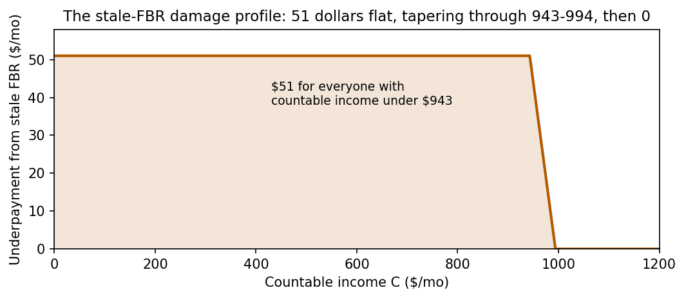

# Results — SSI stale-FBR weight edit

**Verdict: PASS on all four pre-registered gates.** A network
computing SSI with the wrong year's benefit rate was repaired by
changing **2 of its 1,297 parameters**, located by reading the
weights, with no retraining and no reconstruction. The full protocol
was registered in PROTOCOL.md before the edit was designed, and the
stale weights were frozen (FREEZE.json) before the edit script was
written.

## The damage a stale constant does (measured before the edit)

The stale network is *exact* for the formula it encodes — max error
3.3e-13 against the FBR-$943 oracle over 56,381 points. It is a
perfect implementation of last year's rule. Against the current
(2026) oracle:

| Metric | Stale net vs 2026 rule |
|---|---|
| Max abs error | **$51.00** (exactly the FBR gap) |
| Mean abs error | $17.65 |
| Share of inputs within $0.01 | 63.6% |

Every recipient whose countable income falls below the stale FBR is
underpaid by the full $51/month; the error tapers through the
$943–$994 band and vanishes above it. This is the same failure the
CivBench audit found in benefits-as-code labels computed with 2024
constants under a 2026 label.

The damage, as a function of countable income: flat $51 for everyone
under the stale rate, tapering through the $943-$994 band, zero above
it. (Figure: `figures/fig_delta_profile.png`, generated by
`docs/make_writeup_figures.py`.)

## The edit

A value scan of all 1,297 parameters for |value| = 0.943 (the stale
FBR in $k units) finds exactly two sites:

| Parameter | Role | Edit |
|---|---|---|
| `b3[0]` | layer-3 hinge bias, relu(C − FBR) | −0.943 → −0.994 |
| `b4[0]` | output bias, the payment ceiling | +0.943 → +0.994 |

2 / 1,297 = **0.154% of parameters**. (The paper's language-model
repair edited 0.016% of a 0.8B model's parameters; the shape of the
move is the same.) Every other functional appearance of the FBR is
derived from these two sites by the network's own arithmetic.

## Gates

| Gate | Criterion | Result |
|---|---|---|
| G1 exact repair | edited vs 2026 oracle, max err ≤ $1e-9 | **2.3e-13** |
| G2 surgical | ≤ 8 parameters changed | **2** |
| G3 confined effect | functional change = theoretical FBR delta, ≤ $1e-9 | **2.9e-13** |
| G4 control | scan the *trained* SSI net for the constant | **0 hits** (below) |

Confirmation beyond the gates: the edited weight file is
array-for-array identical to the independently constructed 2026
zero-shot network in `../ssi-payment/`. The edit did not approximate
the right network; it reconstructed it exactly.

## The control is the point (G4)

The same scan run on the trained SSI network (same architecture,
trained on the correct 2026 formula) finds **no parameter equal to
0.943, and none equal to 0.994 either** — the nearest parameter to
the true FBR sits 0.080 away, and to the stale FBR 0.029 away. In a
trained network the benefit rate is smeared across hundreds of
weights by gradient descent; there is no place to point at and say
"the rate lives here," and therefore no surgical repair. You would
have to retrain and re-validate the whole network to fix one stale
number.

That asymmetry is the practical content of this experiment:

- **Compiled weights keep program constants legible.** A rate, a
  cap, a threshold sits in the weights as a literal number, in a
  findable place, and changing it changes exactly the behavior the
  rule change implies — verified here to 1e-13.
- **Trained weights do not.** Whatever a trained benefits model has
  absorbed about the rules is not addressable, so it is not
  auditable or repairable at the level of individual provisions.

## Limits (from the protocol, unchanged)

The surgeon knew the construction method from the sibling
experiment; this was not a blind read of a stranger's network (that
is the separate weight-reading experiment, still unrun). And nobody
should carry a live formula in weights when they could carry it in
code — the finding is about what compiled weights make possible for
*verification*: a witness implementation whose constants can be
inspected, diffed year over year, and repaired, which is precisely
what the benefits-as-code label audit needed and did not have.

## Cost

$0 in API or cloud spend. The stale network was constructed and the
edit performed by Muse Spark in-session; all scoring ran locally.
(Project-wide OpenRouter spend lives in `../second-writer-openrouter/`
and `../weight-reading/` — $2.00 total; see those RESULTS.md files.)
