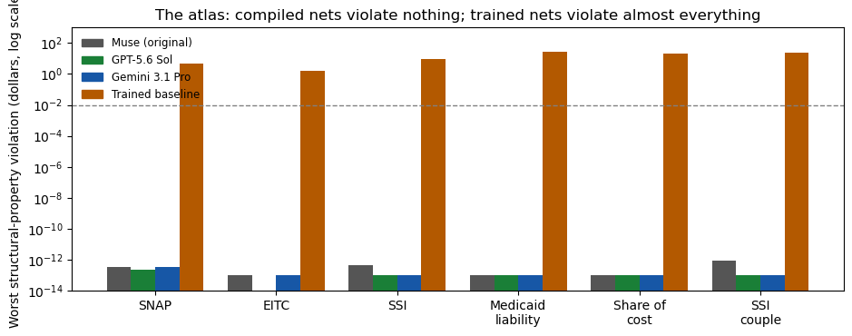

# Results — structural-property atlas

**Verdict: across six rules and 23 property families, no compiled
network — from any of the three writers — violates a single
structural property by more than $0.0000000000005. Every trained
baseline violates most of its rule's properties, including, in
five of six cases, producing outputs the real program cannot
produce at all.**

## The trained baselines, property by property

Worst violations (share of probes violating by more than $0.01 in
parentheses):

| Rule | Violations |
|---|---|
| SNAP | Monotonicity fails both ways: +$100 earned *raises* the allotment by up to $3.01 (23.5%); +$100 shelter *lowers* it by up to $3.25 (27.6%). Outputs fall outside the legal [0, $546] envelope on 21.5% of probes, by up to $4.53. |
| EITC | Phase-in and phase-out monotonicity hold, but the plateau is not a plateau: 98.6% of plateau probes deviate from the pinned $7,152 by more than a cent (max $1.57). Outputs escape [0, $7,152] on 10.9% of probes. |
| SSI | The first-$20 property fails on **100%** of probes: at zero earned income, the net never pays the full $994 across the free unearned band (max shortfall $7.91). The learned exclusion is a smear, not a step. Outputs escape [0, $994] on 16.1%. |
| Medicaid liability | All three monotonicity directions fail (resident income 8.6%, spouse income 11.9%, premiums 6.9%). Outputs go negative or exceed the resident's own income on 9.3% of probes, by up to $28.02. |
| Share of cost | Monotonicity fails on ~10–13% of probes each way (max ~$0.36); outputs go negative on 15.6% (max $5.53 below zero); both CivBench audit probes are missed ($21.90). |
| SSI couple | Member swap moves the answer on 73.4% of probes (max $23.47); outputs escape [0, $1,491] on 48.1%. (Full split-invariance grid: the split-invariance experiment.) |

## The compiled arms

For every compiled arm in every rule — 17 writer/rule combinations
(GPT has no EITC entry; it declined) — the worst adverse amount
across all of that rule's properties is at most 4.4e-13 dollars,
and the share of probes violating by more than a cent is 0.0%
everywhere. This includes properties nobody constructed for
explicitly in this pass: the plateau's flatness, the first-$20
band, liability never exceeding the resident's income. They hold
because the networks compute the stipulated rule, and the
properties *are* the rule, stated structurally.

## What this establishes

- **Accuracy understates learned-model wrongness, systematically.**
  The trained SSI net's mean error was $0.58; its atlas shows it
  fails a named statutory property on every single probe of that
  property. The trained SNAP net's mean error was $0.32; it emits
  illegal allotments on a fifth of probes. A benchmark that reports
  only point accuracy will certify both.
- **Bounds violations are the cleanest possible failure signal.**
  They require no judgement about tolerance: a negative share of
  cost, an allotment above the statutory maximum, a liability
  larger than the income it is charged against are wrong in a way
  that has no near-miss defence.
- **Property suites are cheap and portable.** Every check here is a
  forward pass on perturbed inputs — no labels needed beyond the
  rule's own structure. This is the same standard the split-
  invariance experiment proposed for CivBench, now demonstrated
  across the whole repo: report invariance and property defects
  alongside accuracy for any learned scorer or oracle.

## Cost

**$0.** Local numpy over previously frozen weights (23 property
families x 23 network arms; the full per-property table is in
`results/atlas.json`).
