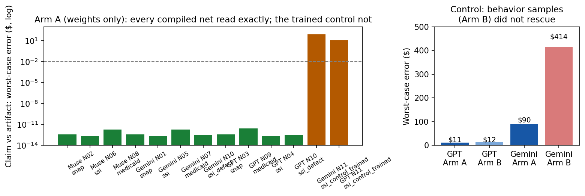

# Results — weight reading

**Verdict: compiled networks are legible to a fresh reader; trained
networks are not, and behavior samples do not rescue them.** Every
compiled artifact in the pack was read *exactly* — behaviorally
identical claimed formula, every defining constant recovered — by
every reader, blind, from the weights alone. The one trained
network was named correctly but could not be read: its benefit rate
is not in the weights to recover, both blind readers invented a
different precise value for it, and giving them input/output
samples made their answers no better (in one case far worse).

## Arm A — weights only (per PROTOCOL.md rubric)

| Reader | Artifact (writer) | R1 family | R2 behavioral max err | R3 constants | Notes |
|---|---|---|---|---|---|
| GPT-5.6 Sol | SNAP (Gemini) | yes | 3.4e-13 | 6/6 | also spotted it was "deliberately hand-encoded rather than trained" |
| GPT-5.6 Sol | SSI (Muse) | yes | 2.3e-13 | 4/4 | |
| GPT-5.6 Sol | Medicaid (Gemini) | yes | 2.7e-12 | 2/2 | flagged MMMNA/PNA as possibly stale (they are current; noted below) |
| GPT-5.6 Sol | **Defect SSI** | yes | 3.3e-13 (vs stale) | 4/4 incl. 943 | **R4: flagged** — "$943 ... stale ... underpay by as much as $51 per month" |
| GPT-5.6 Sol | Control (trained SSI) | yes | $11.35 | 3/4 (read FBR as $1,000) | correctly diagnosed a learned approximation, no output floor (verified: net outputs reach −$1.20) |
| Gemini 3.1 Pro | SNAP (Muse) | yes | 3.4e-13 | 6/6 | anomaly note compared constants to FY2024 figures (artifact is FY2026) |
| Gemini 3.1 Pro | SSI (GPT) | yes | 2.3e-13 | 4/4 | anomaly note doubted 994 against 2024's 943 — constant right, year wrong |
| Gemini 3.1 Pro | Medicaid (Muse) | yes | 1.8e-12 | 2/2 | |
| Gemini 3.1 Pro | **Defect SSI** | yes | 3.3e-13 (vs stale) | 4/4 incl. 943 | **R4: flagged** — "$943 (2024) ... current 2026 law specifies $994" |
| Gemini 3.1 Pro | Control (trained SSI) | yes | $89.54 | 2/4 (read FBR as $914) | |
| Muse (non-blind) | SNAP (GPT) | yes | 3.4e-13 | 6/6 | different staging from Muse's own construction; read exactly |
| Muse (non-blind) | SSI (Gemini) | yes | 2.3e-13 | 4/4 | Gemini's construction puts the FBR in one bias; Muse's used two |
| Muse (non-blind) | Medicaid (GPT) | yes | 1.8e-12 | 2/2 | |

Full scores: `results/armA_scores.json`. Raw replies: `raw/`.

Three things worth pulling out:

1. **The audit scenario works end to end.** Two independent models,
   handed an unlabeled compiled SSI network and a current-law
   sheet, recovered its constants and both identified the stale
   2024 rate — one quantifying the harm at exactly the $51/month
   the stale constant causes. That is the CivBench audit, performed
   on an artifact instead of source code.
2. **Constants exact, context shaky.** Gemini twice recovered every
   constant perfectly while attaching wrong-year skepticism to the
   *correct* constants (doubting 994 because it remembered 943).
   A reader's recovered numbers can be graded mechanically (and
   here they were flawless); its prose about them cannot be taken
   at face value. GPT's anomaly notes showed the same pattern in
   milder form (questioning whether the current MMMNA "may be
   stale"). Audit tooling should surface constants and let humans
   supply the context.
3. **Provenance is visible in structure.** GPT, unprompted, read
   one sparse network as "deliberately hand-encoded rather than
   trained." Sparsity itself is a tell — which cuts both ways: it
   also means a compiled network announces that it is compiled.

## The control: where reading stops

The trained SSI network was identified as SSI by both readers —
the function it *approximates* is recognizable — but its defining
constant could not be recovered, because gradient training never
put it anywhere: GPT read the benefit rate as $1,000, Gemini as
$914 (the net's actual output ceiling is ~$999.97, reached by
smeared approximation, and neither value is "in" the network).
Both stated their wrong constants with confidence 0.88–0.95.
Confident, precise, unverifiable-from-the-artifact: that is what
auditing a trained benefits model would look like, and it is the
strongest argument in this repo for keeping determinations — and
their witnesses — in compiled, legible form.

## Arm B — behavior samples did not rescue the control

Per protocol, the two control reads (R2 < 1) received 25
input/output samples from the trained network and a chance to
revise:

| Reader | Arm A max err | Arm B max err | What happened |
|---|---|---|---|
| GPT-5.6 Sol | $11.35 | $11.91 | rebuilt an approximation of the net's own staged arithmetic; mean error improved ($0.37), max did not |
| Gemini 3.1 Pro | $89.54 | **$414.46** | overfit the 25 samples into a spurious expression; much worse |

The paper's pattern — behavior traces rescuing a weight read —
did not reproduce here, and the reason is structural: samples can
reveal a rule that exists, and a trained net's exact function is
not a rule; it is 1,297 smeared parameters. There was nothing for
the samples to reveal. (Arm B was only owed to reads that failed
Arm A; every compiled read passed Arm A outright, so the rescue
arm had nothing to do there. Full scores: `results/armB_scores.json`.)

## Cost accounting (measured)

12 API calls total: Arm A 10 reads $0.9394; Arm B 2 calls $0.4075;
**total $1.3469 against the $6 abort cap** (per-call figures from
the API's usage accounting, `results/cost_log.json`). Account
cross-check: OpenRouter aggregate usage rose $1.0656 by check time
— the final Gemini Arm B call ($0.2813) had not yet posted to the
aggregate; the per-call accounting is the complete figure. Account
balance $22.32 at check, ~$22.04 after that call posts.
