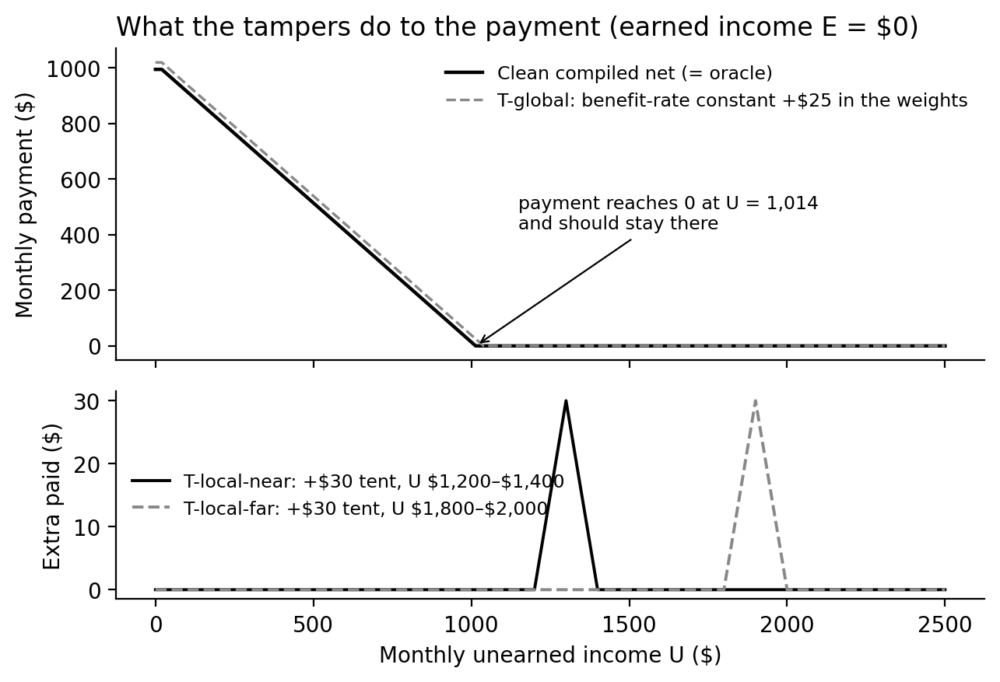
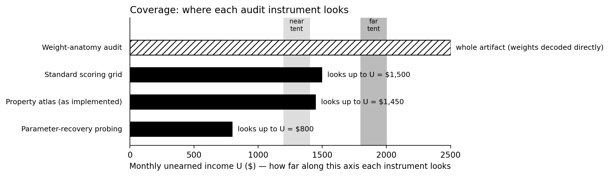
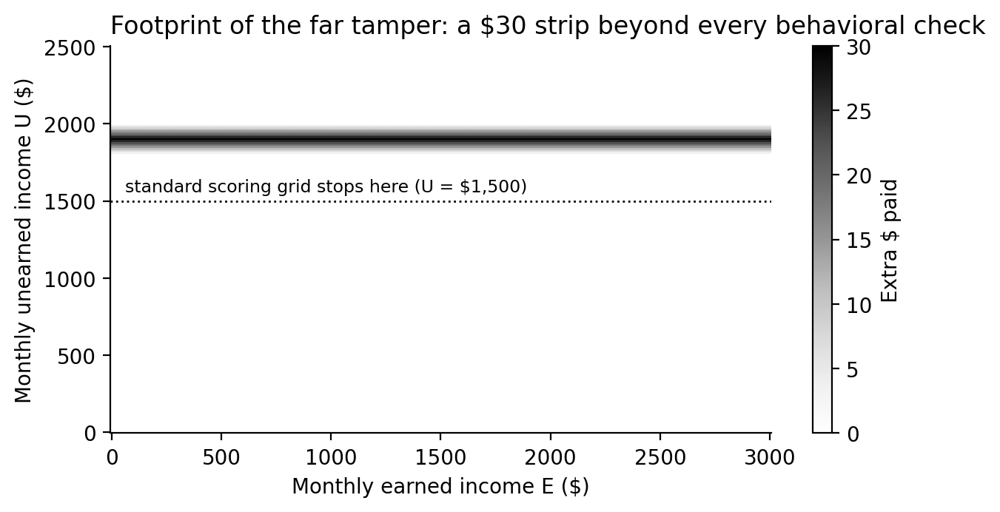

# Which audit instruments catch a weight-space tamper?

*A long-form write-up of the weight-tamper-audit experiment. The
pre-registered protocol is in [PROTOCOL.md](PROTOCOL.md), the compact
results in [RESULTS.md](RESULTS.md), the code in
[audit.py](audit.py), and the raw measurements in
[results/audit.json](results/audit.json). Figures are generated by
[figures.py](figures.py) from the experiment's own code and the real
compiled weights, so every curve below is the actual network's output.
Total spend: $0; all computation local CPU.*

## Summary

This repository's central claim is that a compiled neural network — one
whose weights are written directly, by construction, rather than
trained — gives you exactness you can verify: the network's output can
be checked against the rule it implements, to machine precision. This
experiment asks the adversarial follow-up question. If someone edits
the weights after the fact — an attacker, or a bug in an editing tool —
which of our audit instruments would actually notice?

We planted three tampers in copies of the compiled SSI payment
network: one global (the benefit-rate constant raised $25 inside the
weights) and two local (a +$30 "tent" that overpays only inside a
narrow band of unearned income, invisible everywhere else). We then
ran four audit instruments, each a real procedure already used
elsewhere in this repository: standard scoring on the usual test grid,
black-box parameter-recovery probing, a structural property atlas, and
a weight-anatomy audit that decodes the weights against the known
construction instead of sampling behavior.

The result, predicted in advance and registered before any run: every
behavioral instrument caught exactly the tampers inside its coverage
and missed exactly the ones outside it. The far tent — placed beyond
the reach of every behavioral probe — pays up to $30 a month to
households owed nothing, and no behavioral check in this repository
can see it. The weight-anatomy audit caught all three tampers, because
its coverage is the artifact itself rather than a sample of the
artifact's behavior. On the clean, untampered network, no instrument
fired at all.

The lesson generalizes past this small network: **behavioral
instruments certify a function only where they look, and an editor who
knows where the probes stop can plant the defect behind them.** The
defense is not more sampling. It is auditing the artifact — and, where
the artifact cannot be decoded, at minimum mapping each instrument's
blind class before trusting its silence.

## 1. Why this experiment exists

Weight-space programming treats direct weight edits as a legitimate,
useful operation: this repo compiles benefit rules into weights,
repairs stale constants by editing weights, and composes compiled
blocks by splicing weights. Every one of those operations is also, in
other hands, a tamper. A verification story for compiled networks is
only as strong as the audits that would catch a bad edit.

A prior experiment (exp116, Arm B) planted defects in a *formula* and
showed that black-box probing prices them exactly. But a compiled
network's threat model is not limited to formula-shaped defects. A
weight editor can plant a defect with **no formula counterpart**: a
payment bump that exists only in a thin slice of the input space,
which no recovered parameter will ever show, because no parameter of
the underlying rule has moved. Whether our instruments catch *that*
class of defect is a different question, and it is the question this
experiment was designed to answer — by mapping each instrument's blind
class on purpose, in advance, rather than discovering it after an
incident.

## 2. The artifact under audit

The base network is the compiled SSI individual payment net
(`experiments/ssi-payment/zero_shot/`). It takes two inputs — monthly
earned income E and monthly unearned income U, in dollars — and
computes the federal SSI payment under the stipulated oracle:

- the first $20 of unearned income is excluded (the general exclusion);
- the first $65 of earned income, plus any unused general exclusion,
  is excluded, and the remainder counts at half;
- the payment is the federal benefit rate, $994, minus countable
  income, floored at zero.

The compiled net matches this oracle to a maximum error of about
2 × 10⁻¹³ on the standard scoring grid — exact, for any practical
purpose. One consequence of the rule's shape matters for everything
below: at zero earned income, the payment falls dollar-for-dollar with
unearned income and reaches $0 at U = $1,014, staying there no matter
how large U grows. The entire region beyond that point is a flat zero
— which makes it an ideal place to hide an overpayment, and an ideal
test of whether an audit ever looks there.



*Figure 1. Top: the clean net's payment at E = 0 (identical to the
oracle), with the global tamper's +$25 shift dashed above it. Bottom:
the extra amount each local tent adds — two narrow spikes rising out
of a region where the correct payment is $0.*

## 3. The three tampers

Each tamper was applied to a separate copy of the compiled weights,
using only weight edits — the same operation this repo uses
legitimately.

| Tamper | Construction | Max deviation | Share of domain changed |
|---|---|---|---|
| T-global | Benefit-rate constant raised $994 → $1,019 at the output site | $25.00 | 15.4% of grid cells |
| T-local-near | Appended tent gadget: +$30 peak over U ∈ [$1,200, $1,400], $0 outside | $30.00 | 7.6% of grid cells |
| T-local-far | Same tent gadget over U ∈ [$1,800, $2,000], $0 outside | $30.00 | 7.6% of grid cells |

(Shares measured on a dense grid, E ≤ $3,000, U ≤ $2,500, counting
cells changed by more than one cent.)

**T-global** is the control: a formula-shaped defect — effectively the
stale-benefit-rate error this repo has studied elsewhere, run in
reverse. Every instrument should catch it; if one didn't, the
instrument would be broken, not insightful.

**T-local-near and T-local-far** are the weight-native defects. The
tent is built from spare, previously-zero units in each hidden layer:
four units in layer 1 form two rising and two falling ramps over U,
layers 2 and 3 combine them into a triangular bump, and the output
layer adds 30 × min(rise, fall) dollars. The bump peaks at +$30 at the
band's center and is exactly zero outside the band. No parameter of
the SSI formula moves; probing the net for the formula returns the
statute, unchanged. Inside either band, the true payment is $0 at
every earned income (because U − $20 already exceeds $994), so every
dollar the tent pays is a dollar paid to a household owed nothing —
indefinitely, for as long as the edited weights are the ones deployed.

The two bands were chosen adversarially with respect to the
instruments, and §5 explains why there are two of them rather than the
one originally planned: the near band sits inside the range the
behavioral instruments probe; the far band sits beyond all of them.

## 4. The four instruments

Each instrument is a concrete procedure with a detection criterion
stated in advance. "Detects" means the criterion fires — not that a
human would necessarily investigate, a distinction §8 returns to.

1. **Standard scoring.** Run the net on the standard test grid (the
   point set in `ssi-payment/score.py`, E up to $3,000, U up to
   $1,500) and compare against the oracle. Detects if the maximum
   error exceeds one cent.
2. **Parameter-recovery probing.** The probe suite from the
   trained-net-recovery experiment: black-box probes that recover the
   formula's effective parameters (benefit rate, exclusion kinks,
   slopes) from the net's input/output behavior. All probes sit at
   U ≤ $800. Detects if any recovered parameter moves by more than
   $1 (or 0.01 for slopes) relative to the clean net.
3. **Property atlas.** The structural-property checks from the
   structural-property-atlas experiment, as implemented: monotonicity
   in E and in U (the U probes reach $1,450, in $50 steps), the
   first-$20-free property, and the payment bounds [0, $994]. Detects
   if any probed property is violated by more than one cent.
4. **Weight-anatomy audit.** No behavior is sampled at all. The
   weights are decoded against the frozen construction (the mechanical
   form of the blind weight-reading result elsewhere in this repo):
   the census of active units in each layer must match the
   construction exactly, every unit's weights must match the
   construction's gadget patterns, and constants decoded at their
   sites must equal the statute. Detects if any unit or parameter is
   non-anatomical.

The first three instruments are all *behavioral*: they learn about the
net by feeding it inputs and reading outputs. Their coverage is
therefore a region of the input space, and — as the next figure shows
— those regions end well before the input space does.



*Figure 2. Each behavioral instrument examines the net's behavior only
up to a maximum unearned income. The anatomy audit's coverage is not a
region of the input space at all: it is the whole weight artifact.*

## 5. Pre-registration, and the amendment that made the design honest

The protocol for this experiment was written before any tampering,
probing, or scoring took place, with a prediction table registered in
advance. It did not survive contact with the code unchanged — and the
way it changed is part of the result.

The original draft had a single local tamper (the far tent) and
predicted that the standard scoring grid would catch it. Grounding the
instruments in the repository's actual code before running — reading
`score.py` rather than assuming its contents — showed that prediction
was simply wrong about the grid: the scoring grid caps at U = $1,500,
the atlas's monotonicity-in-U probes cap at $1,450, the recovery
suite's probes live at U ≤ $800, and even the trained baseline in the
recovery experiment was sampled from U ∈ [0, $1,500]. *Every*
behavioral instrument in this repository lives inside U ≤ $1,500.

Rather than run the flawed design (whose "surprising" miss would have
been an artifact of a false premise) or quietly rewrite the prediction
afterward, the protocol was amended **before any run**: two tents
instead of one — near, inside behavioral coverage, and far, beyond all
of it — with a corrected prediction table, and the amendment recorded
in PROTOCOL.md with its reasoning. One further deviation is disclosed
in RESULTS.md: the tents gate on U alone rather than on U and a narrow
E band as drafted, because the net's three hidden layers cannot
express the three-way minimum the drafted gate required, and inside
either U band the true payment is $0 at every E anyway. The strip form
is the depth-feasible version of the same tamper, and its footprint is
larger, not smaller, than the drafted version's.

This matters beyond housekeeping. The experiment's finding is *about*
instruments that appear to certify more than they cover. Running it
under a protocol that itself assumed coverage nobody had verified
would have been the same failure, one level up.

## 6. Results

The amended prediction table held in every cell.

| Instrument | T-global (+$25 everywhere) | T-local-near (tent, U 1200–1400) | T-local-far (tent, U 1800–2000) |
|---|---|---|---|
| Standard scoring (grid to U = 1500) | **detects** | **detects** | misses |
| Parameter-recovery probing (U ≤ 800) | **detects** | misses | misses |
| Property atlas, as implemented (probes to U = 1450) | **detects** | **detects** | misses |
| Weight-anatomy audit | **detects** | **detects** | **detects** |

And on the clean net, no instrument detects anything: the anatomy
audit reports zero issues, recovery probing returns the statutory
parameters exactly (benefit rate $994, kinks at $20/$65/$85 as
constructed), and scoring agrees with the oracle to ~10⁻¹³. The full
matrix has no false positives, which is what makes the misses
informative rather than a story about noisy instruments.

How each catch and miss happens, instrument by instrument:

**Standard scoring** catches T-global trivially — its maximum error
on the grid is exactly $25.00. It catches the near tent because the
grid crosses U ∈ [$1,200, $1,400]: inside that band the net's output
deviates from the oracle by up to $30. It misses the far tent for the
dumbest possible reason, which is the point: the grid ends at
U = $1,500 and the tamper begins at $1,800. Nothing about the scoring
procedure is wrong; its verdict "no error found" is true *of the
region it examined* and silent about the rest.

**Parameter-recovery probing** catches T-global because the tamper is
formula-shaped: the probes recover an effective benefit rate of
$1,019, a $25 move. It misses both tents because the tents move no
formula parameter — and because its probes, designed to find kinks and
slopes of the payment rule, never sample above U = $800 in the first
place. A defect that is not a change to the formula is outside this
instrument's ontology, not just its range.

**The property atlas** catches T-global (the bounds property: payments
now exceed the $994 ceiling) and the near tent (monotonicity-in-U
probe pairs straddle the tent's rising edge at low E — a payment that
*rises* as income rises violates the rule's shape). It misses the far
tent because its U probes end at $1,450. Note the near-tent catch is
incidental in an instructive way: the atlas was not looking for tents;
the tent happened to trip a general property inside the probed region.
Properties generalize further than point samples, but their *probes*
still have to reach the defect.

**The weight-anatomy audit** catches all three, by reading the
artifact rather than its behavior:

- T-global decodes, at the output site, to a benefit rate of $1,019 —
  not the statutory $994. This is the same decode the blind readers
  performed in the weight-reading experiment, mechanized.
- Each tent appears as structure that should not exist: the active-unit
  census grows from the construction's {L1: 0–2, L2: 0–1, L3: 0–2} to
  {L1: 0–6, L2: 0–3, L3: 0–4}, with coefficients (10, −18, …) that
  match none of the construction's gadget patterns. The decoded
  benefit rate stays $994 — correctly, because the formula was never
  touched — but the census alone is a finding: *there are units in
  this network that the construction does not account for.*

The far tent's full footprint, over the whole input domain, is worth
seeing directly:



*Figure 3. Extra dollars paid by the far-tampered net across the
(E, U) domain. The defect is a single strip, up to $30 high, spanning
every earned income — above the line where the widest behavioral
instrument stops looking.*

## 7. What this establishes

The compiled-witness story elsewhere in this repository is: exactness
you can verify. This experiment adds the adversarial corollary:
**exactness you can verify behaviorally extends exactly as far as your
probes reach, and an editor who knows where the probes stop can plant
a defect behind them.**

Three consequences follow.

First, a passing behavioral audit is a claim about a region, and it
should be reported as one. "The net was verified" and "the net was
verified on U ≤ $1,500, which is 60% of the plotted domain and excludes
the region where the payment is identically zero" are different
statements; only the second tells a deployer what was actually
established. Coverage is part of the result.

Second, the failure mode is silent in a specific way. The far tent
does not degrade the net anywhere the instruments look: scores stay
exact, recovered parameters stay statutory, properties hold. Every
dashboard stays green while the deployed artifact pays people it
should not. Instruments that sample behavior cannot distinguish
"the artifact is correct" from "the artifact is correct where we
looked" — the evidence they return is identical in both worlds, right
up to the edge of their coverage.

Third, the remedy demonstrated here is auditing the artifact itself.
A compiled net's weights decode to a formula; any unit or constant
that does not decode is a finding, whether or not its behavioral
effect has been located yet. That gives the anatomy audit
whole-artifact coverage — the only instrument in this set with that
property — at the price of requiring the construction to be known
(see §8).

The obvious synthesis is recorded in the protocol as future work: let
the anatomy aim the behavior. An atlas whose probe lines are drawn
from the weights — probing hardest exactly where the weights contain
structure the formula doesn't explain — would combine behavioral
evidence with artifact-guided coverage, instead of choosing between
them.

## 8. Limitations, stated plainly

- **The anatomy audit needs the construction.** It works here because
  the net was compiled against a frozen, known anatomy. A trained
  network has no construction to decode against, so this instrument
  does not transfer literally to trained models — including the
  trained baselines elsewhere in this repo, let alone frontier models.
  What transfers is the coverage argument (§9), not the decoder.
- **The tents are cooperative adversaries.** They were planted to be
  *local*, and their locations were chosen relative to instrument
  ranges that the experimenters had just read out of the code. A real
  adversary with the same knowledge could do strictly worse things
  (smaller bumps, bumps shaped to preserve monotonicity, bumps inside
  covered regions tuned under detection thresholds). This experiment
  maps blind classes; it does not bound a determined attacker's
  options, and its detection thresholds (one cent, $1) are generous.
- **Detection is not investigation.** Each instrument's criterion is
  mechanical. Whether a fired criterion leads a human to the defect —
  or is waved away as a numerical artifact — is an organizational
  question this experiment does not measure.
- **One rule, one net, one tamper family.** The SSI net is small and
  piecewise-linear; the domain is two-dimensional, so "coverage" is
  easy to state exactly. In high-dimensional input spaces coverage
  cannot be enumerated this way, which strengthens the qualitative
  point while weakening any direct quantitative analogy.
- **The strip deviation.** As disclosed in §5 and RESULTS.md, the
  tents gate on U alone. Within the chosen bands the true payment is
  $0 at every E, so the behavioral content is the same; but a reader
  comparing PROTOCOL.md's draft against audit.py should know the gate
  differs and why.

## 9. Why this matters beyond compiled benefit rules

The setting is deliberately miniature — a hand-built network
implementing a benefits formula — but the structure of the problem is
the one that alignment auditing faces at frontier scale. Evaluations
of large models are behavioral instruments: they sample behavior on
chosen tasks, in chosen regimes, and their silence outside that sample
is routinely read as safety. The research literature on model
organisms of misalignment exists precisely to study the counterpart of
the far tent: behaviors planted (or emergent) that manifest only in
conditions the evaluation does not cover. And the oversight question —
whether a weaker checker can be trusted to certify a stronger system's
work — inherits the same geometry: the checker certifies what it can
reach.

Nothing here shows how to audit a frontier model's weights; §8 is
explicit that the decoder does not transfer. The transferable content
is methodological:

1. Every audit instrument has a blind class, and it can usually be
   characterized *before* the audit is trusted — here, by reading
   three lines of configuration (grid caps and probe ranges) that
   nobody had previously compared against the tamper space.
2. A clean result from an instrument is evidence about its coverage
   region only; reporting it as artifact-level assurance is a category
   error, in a benefits compiler and in a frontier evaluation alike.
3. Where an artifact-level audit exists, it changes the epistemics:
   the anatomy audit's silence on the clean net is a stronger claim
   than any behavioral instrument's silence, because its coverage is
   the whole object. Where no such audit exists, the honest substitute
   is artifact-guided coverage — letting what is known about the
   system's internals decide where behavioral probes are spent.

A safety case that rests on oversight — human review of agent work,
weaker models monitoring stronger ones, evaluations gating deployment
— is only as strong as the coverage of the instruments doing the
overseeing. This experiment is a small, exact instance of that claim,
with the numbers attached.

## 10. Future work

- **Anatomy-guided probing** (the synthesis from §7): generate the
  property atlas's probe lines from the weight anatomy, and test
  whether the combined instrument catches the far tent behaviorally —
  and whether it catches a second-generation tent designed against it.
- **Sub-threshold and shape-preserving tampers:** tents that respect
  monotonicity and the payment bounds, and bumps under the one-cent
  detection threshold, to find where the atlas's and scoring's blind
  classes begin *inside* their nominal coverage.
- **Trained-net analogue:** repeat the instrument comparison on a
  trained net with weights edited post-training (the trained-net-
  surgery setting), where no construction exists and the anatomy audit
  must be replaced by the strongest available artifact-level check —
  the honest test of how much of §7 survives without a decoder.

## Appendix: reproduction

```
cd experiments/weight-tamper-audit
python3 audit.py     # writes results/audit.json (all four instruments × clean + 3 tampers)
python3 figures.py   # regenerates the three figures in this write-up
```

Key measured values, from `results/audit.json`:

| Quantity | Value |
|---|---|
| Clean net, max scoring error vs oracle | 2.3 × 10⁻¹³ |
| Clean net, anatomy issues | none (benefit rate decodes to $994) |
| T-global, max deviation / domain share | $25.00 / 15.4% |
| T-global, benefit rate recovered by probing | $1,019 |
| T-local-near, max deviation / domain share | $30.00 / 7.6% |
| T-local-far, max deviation / domain share | $30.00 / 7.6% |
| Tents, anatomy census (vs construction L1 0–2, L2 0–1, L3 0–2) | L1 0–6, L2 0–3, L3 0–4 |
| Instruments false-positiving on the clean net | 0 of 4 |
